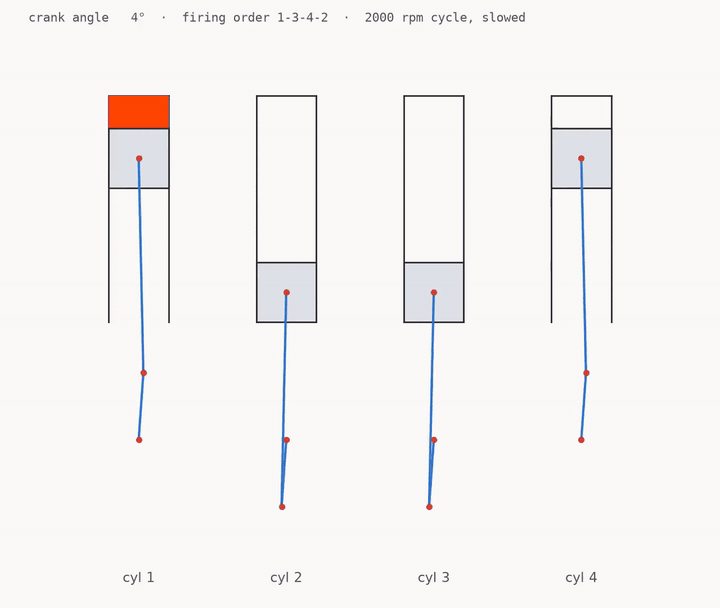
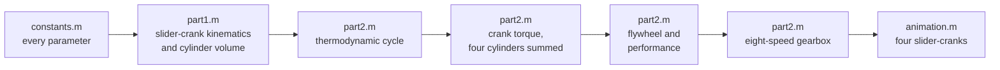
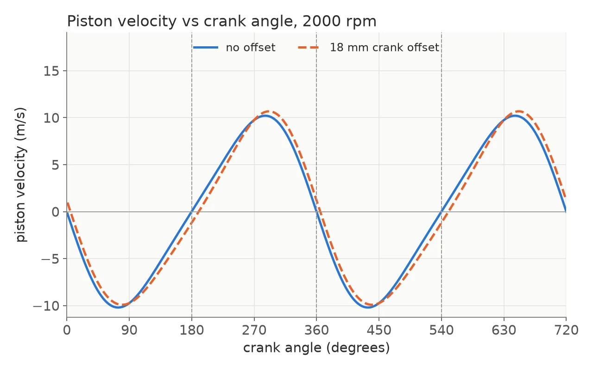
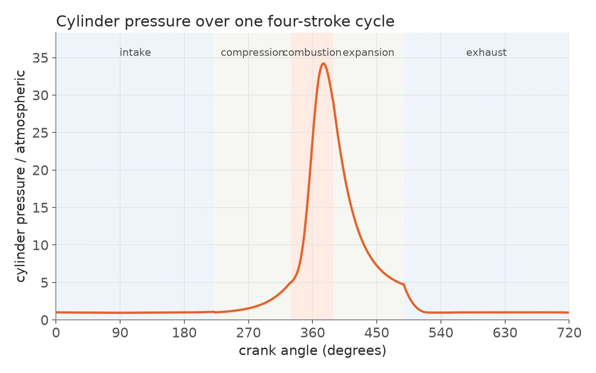
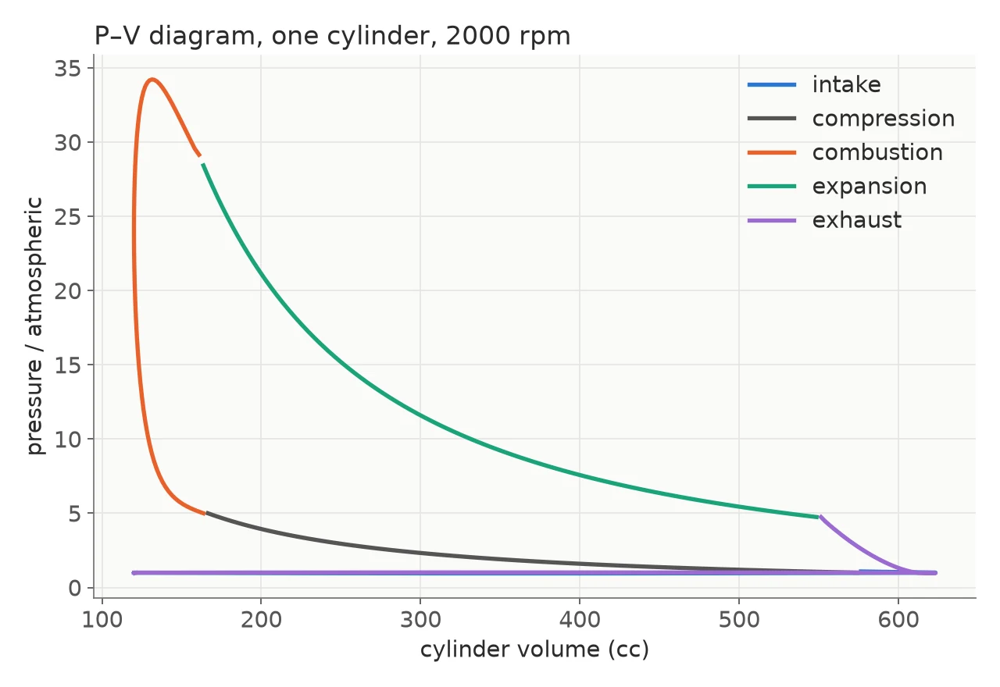
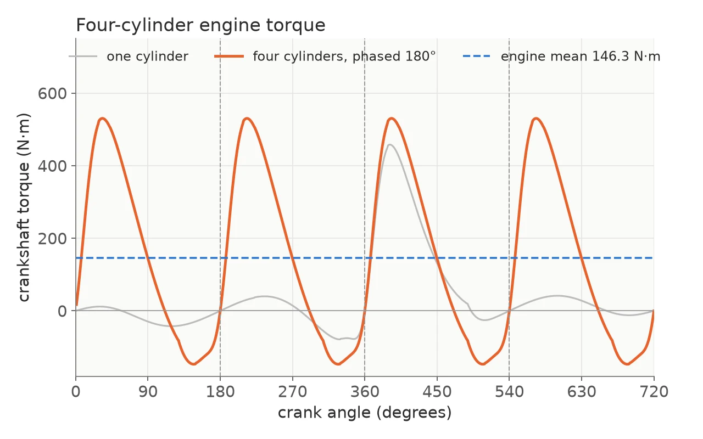
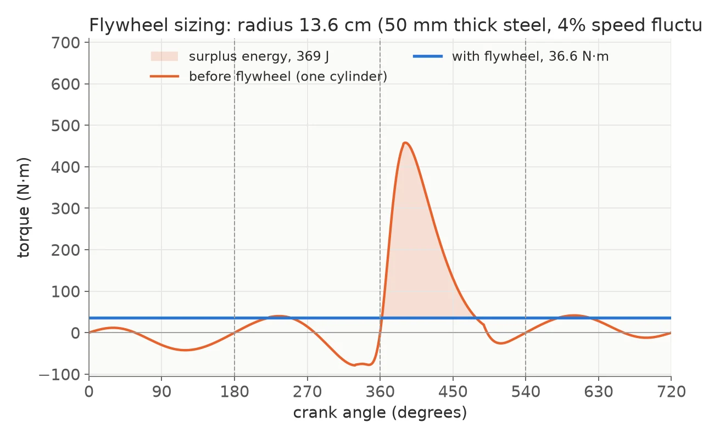
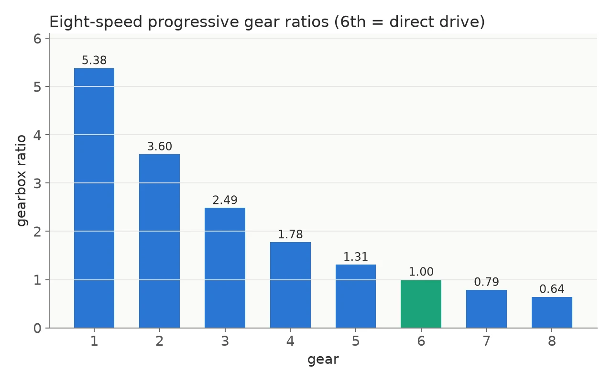

# Four-cylinder engine simulator

A chain of MATLAB scripts that follows a four-stroke, four-cylinder spark-ignition engine from the geometry of its crank, through the gas in its cylinders, to the gear ratios of the car it drives.




*The four-cylinder animation from `animation.m`: one full 720° cycle, firing order 1-3-4-2 (sped up).*

## What it is

I wrote this simulator as the main project of the Automotive Engineering course at RHU, in fall 2024. It models one engine at 2000 rpm over a full cycle of 720° of crank rotation.

An engine is one chain of dependencies. The crank geometry sets the cylinder volume, the volume sets the pressure, the pressure and the moving masses set the torque, and the torque decides the flywheel and the gearbox. The scripts are built the same way: every stage takes the previous one's output as its input, so a change to one parameter runs through every result downstream.

## Results

For the engine in the assignment:

| Quantity | Value | Notes |
| --- | --- | --- |
| Engine power | 30.6 kW | indicated, four cylinders at 2000 rpm |
| Mean torque | ~146 N·m | four cylinders, 180° apart |
| Fuel conversion efficiency | 28% | |
| Work per cylinder per cycle | ~460 J | area of the P–V loop |
| Peak cylinder pressure | ~34 atm | just after top dead centre |
| Flywheel radius | 13.6 cm | steel disc 50 mm thick, 4% speed fluctuation |
| Gear ratios (1st to 8th) | 5.38 / 3.60 / 2.49 / 1.78 / 1.31 / 1.00 / 0.79 / 0.64 | sixth is direct drive |

## How it works



**1. One file of numbers.** `constants.m` holds every input: link lengths and masses, the engine speed, the timing of intake, compression, combustion, expansion and exhaust in crank degrees, the gas properties, and the flywheel and transmission constants. Each later script loads the `.mat` file the one before it saved.

**2. The slider-crank.** `part1.m` solves the slider-crank at every crank angle: piston position, velocity and acceleration, the angle of the connecting rod, and the cylinder volume. It does this twice, once with the cylinder axis through the crankshaft (compression ratio 9.8) and once offset by −18 mm (10.1). The same pass computes the rod's angular velocity and acceleration and the accelerations of each part's centre of mass, which the torque needs later.



**3. A cycle that has to agree with itself.** `part2.m` runs a single-zone thermodynamic cycle over that volume. Compression and expansion are polytropic. Combustion takes 60° around top dead centre: a constant-volume heat addition from the fuel's heating value gives the end-of-combustion temperature, and a Wiebe function (a = 5, m = 2) sets how much of the charge has burned at each angle in between. Exhaust blowdown and intake are compressible flow through a valve orifice, and the leftover exhaust gas mixes with the fresh charge. That mixture sets the temperature at the start of the next compression, so the script repeats the cycle until the temperature at the end of intake matches the one it started compression with.

| | |
| --- | --- |
|  |  |
| Pressure over the 720° cycle. | The P–V loop of one cylinder; its area is the work per cycle. |

**4. From gas pressure to crank torque.** At every crank angle the script writes the force and moment balances for the crank, the connecting rod and the piston (their masses, the rod's inertia, gravity and the gas force) as an 8×8 linear system and solves it for the crank torque. The other three cylinders are the same curve shifted by 180°, 360° and 540°, and the sum is the torque of the engine.



**5. Flywheel and performance.** The script integrates the energy of the torque above its mean between the crossings and sizes a flywheel to hold the speed fluctuation to a coefficient of 0.04, as a steel disc 50 mm thick. The same run prints the work per cycle, indicated and brake power, MEP and BMEP, efficiencies, specific fuel consumption, volumetric efficiency and mean piston speed.



**6. Gearbox.** The top gear comes from a top speed of 245 km/h, the first gear from what it takes to move a 2600 kg vehicle up a 7% grade while accelerating, and `fsolve` finds the two factors of a progressive series of eight ratios between them.



**7. Animation.** `animation.m` draws the four slider-cranks moving together and flashes each cylinder as it fires, which makes the phase shift the torque sum depends on visible.

## Quick start

You need MATLAB. `part2.m` calls `fsolve`, which comes with the Optimization Toolbox.

1. Open MATLAB with the repository root as the current folder.
2. Run the scripts in order:

   ```matlab
   constants   % saves constants.mat
   part1       % kinematics and volume, saves part1.mat
   part2       % cycle, torque, flywheel, performance, gearbox; saves part2.mat
   animation   % the four-cylinder animation
   ```

Each script loads the `.mat` file the previous one saved and opens its own figures. The `.mat` files are committed, so you can also start from any step. Results print to the Command Window.

## Repository layout

```
.
├── constants.m     every parameter -> constants.mat
├── part1.m         slider-crank kinematics and cylinder volume -> part1.mat
├── part2.m         cycle, torque, flywheel, performance, gearbox -> part2.mat
├── animation.m     four-cylinder animation
├── *.mat           saved workspaces from each step
├── submission/     the same scripts and .mat files, as handed in
└── docs/media/     images for this README
```

## Limits

These are coursework scripts, and they make simplifications on purpose.

- The mean effective pressures the scripts print (MEP and BMEP) are about half what they should be: the displacement constant is smaller than the engine's swept volume of about 503 cc.
- Friction is a flat 10% of indicated power. There is no heat transfer to the cylinder walls, no emissions model and no knock.
- The engine turns at one fixed speed, and the speed-fluctuation curve is an idealised sine between the flywheel's limits, not a simulation of the shaft.

## Links

- Project page: [ramikronbi.com/projects/ice-engine-simulator](https://ramikronbi.com/projects/ice-engine-simulator)
- Write-up: [Simulating an engine from crank to gearbox](https://ramikronbi.com/writing/simulating-an-engine-from-crank-to-gearbox)

Built by Rami Kronbi as the main project of the Automotive Engineering course at Rafik Hariri University (RHU), fall 2024. [ramikronbi.com](https://ramikronbi.com)
