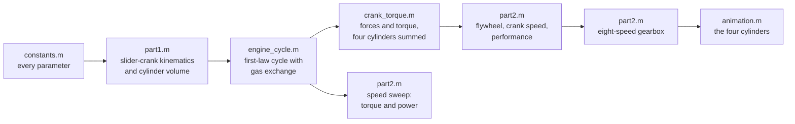
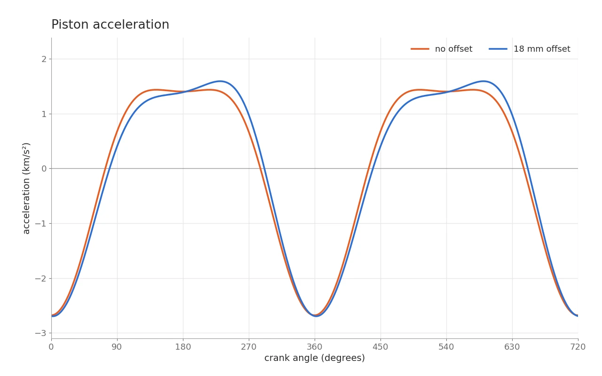
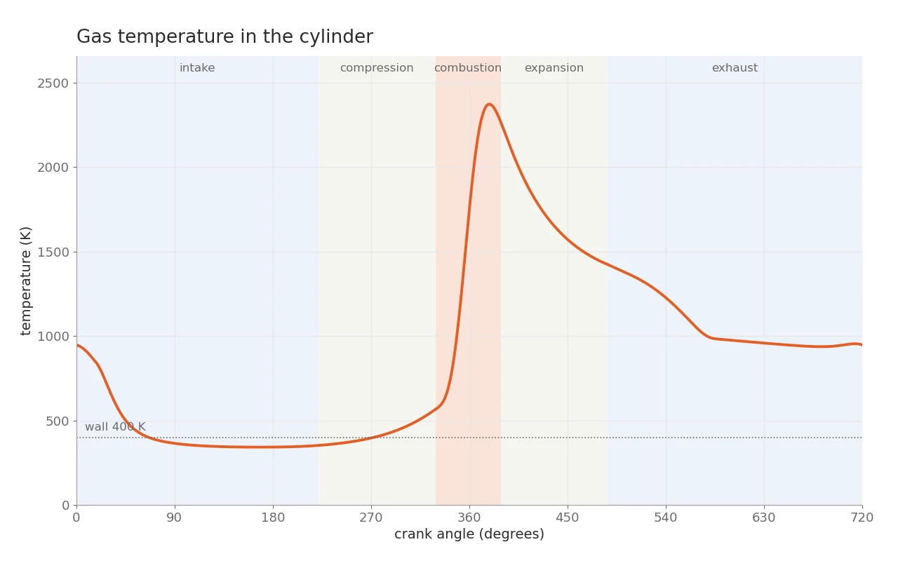
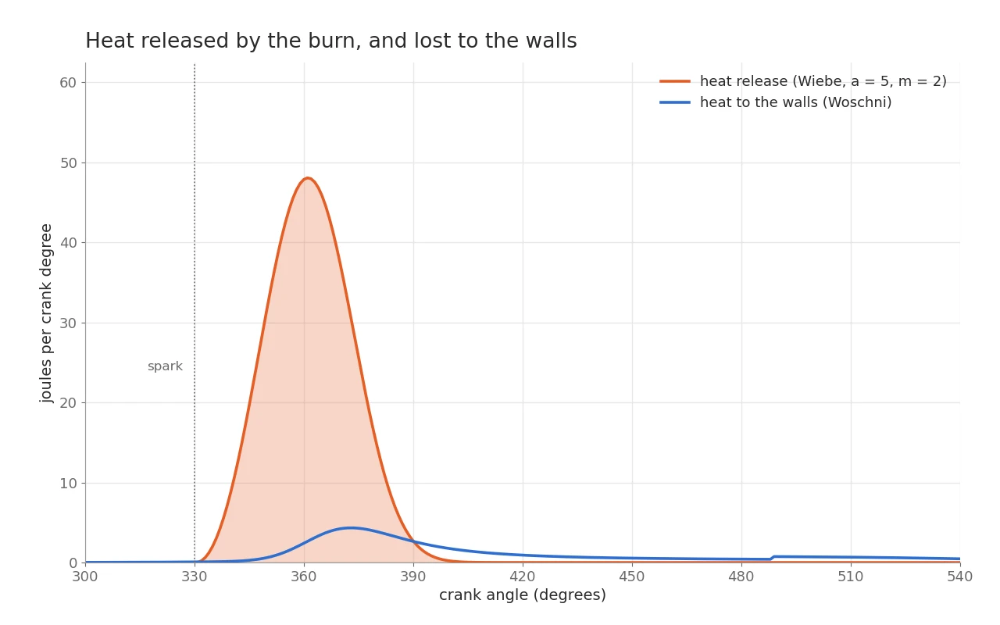
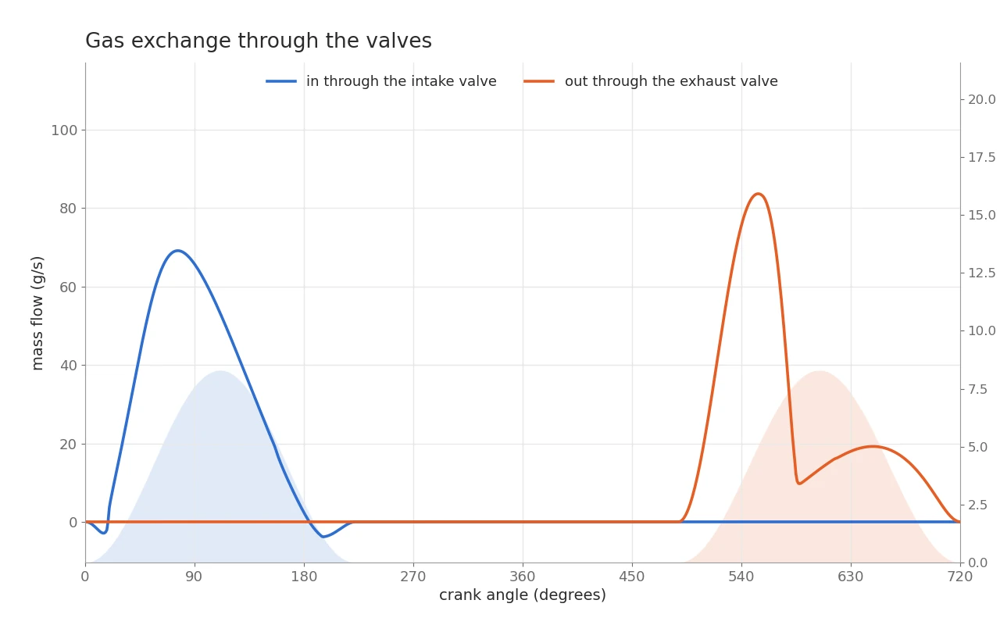
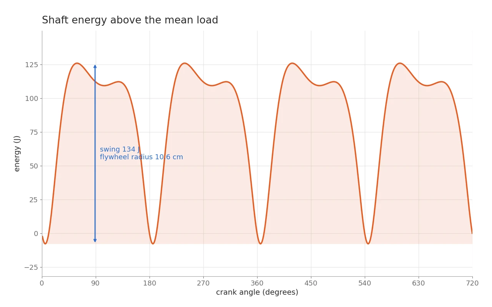
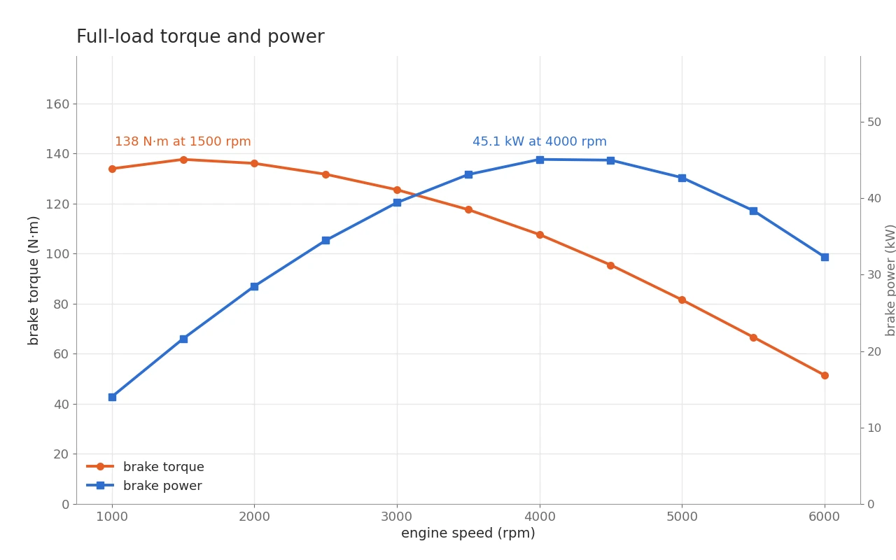

# Four-cylinder engine simulator

A chain of MATLAB scripts that follows a four-stroke, four-cylinder spark-ignition engine from the geometry of its crank, through the gas in its cylinders, to the torque curve of the engine and the gear ratios of the car it drives.


[](docs/media/engine-simulation.mp4?raw=true)

*One full cycle of the simulated engine, drawn from the scripts' own results. Click it for the 1080p60 video.*

## Watch it run

| [](docs/media/engine-simulation.mp4?raw=true) | [](docs/media/simulation-run.mp4?raw=true) |
| --- | --- |
| **[The engine, simulated](docs/media/engine-simulation.mp4?raw=true)**: 24 s, 1080p60, three cycles 133× slower than 2000 rpm. Pistons, rods and cranks move to scale with the kinematics of `part1.m`. The gas column is the cylinder volume, coloured by the gas temperature. The flame grows with the burned fraction, and the valves lift and the ports light up as the gas-exchange model has them. The charts follow the same crank angle: pressure in all four cylinders, the P–V loop of cylinder 1, and the crank torque. | **[A full run, every output](docs/media/simulation-run.mp4?raw=true)**: 69 s, 1080p. The scripts run in GNU Octave. The console replays every line they print, from the kinematics check to the speed sweep and the gear ratios, and each of the 15 figures draws itself in as its script opens it. The video ends on the results. |

Both videos also play in the browser on the [project page](https://ramikronbi.com/projects/ice-engine-simulator).

## What it is

I wrote this simulator as the main project of the Automotive Engineering course at RHU, in fall 2024. It models one engine through a full cycle of 720° of crank rotation, at a design speed of 2000 rpm and at full load from 1000 to 6000 rpm.

An engine is one chain of dependencies. The crank geometry sets the cylinder volume, the volume and the valves set how much charge the cylinder holds, the burn and the walls set the pressure, the pressure and the moving masses set the torque, and the torque decides the flywheel and what the gearbox has to work with. The scripts are built the same way: every stage takes the previous one's output as its input, so a change to one parameter runs through every result downstream.

The scripts here are a rework of the ones I handed in, which are kept as they were in [`submission/`](submission). The rework fixes the bugs listed under [What was fixed](#what-was-fixed), replaces the thermodynamic model with a first-law cycle simulation, and adds heat transfer, real gas exchange, a friction model, a speed sweep and a simulated crank speed.

## Results

For the engine in the assignment, a 2.0 L four-cylinder with an 83 mm bore, a 93 mm stroke and a compression ratio of 9.8:

| Quantity | Value | Notes |
| --- | --- | --- |
| Peak brake torque | 138 N·m at 1500 rpm | full load |
| Peak brake power | 45.1 kW at 4000 rpm | one 33 mm valve per port limits the breathing |
| At 2000 rpm | 28.5 kW, 136 N·m, BMEP 8.5 bar | IMEP 10.0 bar net, friction 1.5 bar |
| Fuel conversion efficiency | 28.6% brake, 34.2% indicated | BSFC 289 g/kWh at 2000 rpm |
| Volumetric efficiency | 85% at 2000 rpm | 61% at 6000 rpm |
| Peak cylinder pressure | 59 bar, 9° after top dead centre | peak gas temperature 2373 K |
| Heat to the walls | 19% of the fuel energy released | Woschni |
| Residual gas | 5.4% of the trapped charge | exhaust at 1117 K |
| Flywheel radius | 10.6 cm | steel disc 50 mm thick, 4% speed fluctuation, 134 J energy swing |
| Gear ratios (1st to 8th) | 5.48 / 3.64 / 2.50 / 1.78 / 1.31 / 1.00 / 0.79 / 0.64 | sixth is direct drive |

## How it works



**1. One file of numbers.** `constants.m` holds every input: link lengths and masses, the engine speed and the speeds to sweep, the valve and spark timing in crank degrees, the gas and fuel properties, the Wiebe and heat-transfer constants, the friction correlation, and the flywheel and vehicle constants. Each later script loads the `.mat` file the one before it saved.

**2. The slider-crank.** `part1.m` solves the slider-crank in closed form (`slider_crank.m`) at every crank angle: piston position, velocity and acceleration, the rod's angle, angular velocity and angular acceleration, and the accelerations of each part's centre of mass, which the torque needs later. It does this twice, once with the cylinder axis through the crankshaft (compression ratio 9.8) and once offset by −18 mm (10.1). It checks the analytic velocities and accelerations against numerical derivatives of the positions, and prints the largest error: under 10⁻⁴.

| | |
| --- | --- |
|  |  |
|  |  |

**3. The cycle.** `engine_cycle.m` follows the gas in one cylinder through the whole 720° as an open system, in steps of a tenth of a degree. Each step applies the first law: the work of the volume change, the heat the burn releases, the heat lost to the walls and the energy carried through the valves.
- **Burn.** A Wiebe function (a = 5, m = 2) releases the fuel's heat over 60° from a spark at 30° before top dead centre. The fuel is worked out from the fresh charge trapped when the intake valve closes, not from the residual gas.
- **Walls.** Woschni's correlation gives the heat transfer to walls at 400 K, with the combustion term that follows the burn.
- **Valves.** Each valve lifts and falls on a smooth profile to a quarter of its diameter. The gas flows through the valve's curtain area as compressible flow, choked or subsonic, in either direction, so the model has blowdown, backflow and the residual gas the exhaust leaves behind.
- **Gas.** The fresh mixture and the burned gas have their own ratio of specific heats (1.3 and 1.25), mixed by the burned fraction.
- **Repetition.** The cycle repeats from its own end state until the state at 720° matches the one it started from, to 10⁻⁵.

| | |
| --- | --- |
|  |  |
|  |  |



**4. From gas pressure to crank torque.** At every crank angle `crank_torque.m` writes the force and moment balances for the crank, the connecting rod and the piston (their masses, the rod's inertia, gravity, the gas force and the crankcase pressure) as an 8×8 linear system and solves it for the crank torque. It runs a second time with the masses set to zero, which separates the torque of the gas from that of inertia and gravity. The other three cylinders are the same curve shifted by 180°, 360° and 540° (firing order 1-3-4-2), and the sum is the torque of the engine. As a check, `part2.m` prints the mean of that torque beside the work of the P–V loop: they agree to 0.01 N·m.

| | |
| --- | --- |
|  |  |

**5. Flywheel and crank speed.** The integral of the engine torque above its mean gives the shaft's energy over the cycle. Its largest swing, 134 J, sizes a flywheel that holds the speed fluctuation to 4%, as a steel disc 50 mm thick. The script then works out the crank speed that flywheel allows against a steady load: the speed swings by exactly the 4% it was designed for.

| | |
| --- | --- |
|  |  |

**6. Performance and the speed sweep.** From the cycle the script works out gross and net IMEP, the pumping loss, friction from Heywood's correlation for four-cylinder SI engines, BMEP, indicated and brake power and torque, fuel conversion efficiencies, BSFC, volumetric efficiency, residual fraction and the share of the fuel's energy lost to the walls. It then runs the cycle at every speed from 1000 to 6000 rpm for the full-load torque and power curves.



**7. Gearbox.** The top gear comes from a top speed of 245 km/h at 4000 rpm. The first gear comes from what it takes to move a 2600 kg vehicle up a 7% grade while accelerating, with the 450 N·m engine torque the assignment designs the gearbox around. The eight ratios follow a progressive series with sixth as direct drive. Its two factors are solved exactly: the two conditions are linear in their logarithms. Under each gear is the road speed at 4000 rpm.


**8. Animation.** `animation.m` runs the four cylinders from the results. The pistons move with the kinematics, the valves lift as the gas-exchange model has them, the gas takes the colour of its temperature, and a spark marks each ignition. The [engine video](docs/media/engine-simulation.mp4?raw=true) at the top is the same picture, drawn in more detail.

## What was fixed

The scripts as handed in ([`submission/`](submission)) ran, but several results were wrong. The effects below are measured on the results they saved:

| Bug | Effect | Fix |
| --- | --- | --- |
| The swept volume used `max(s)`, the crank-to-piston-pin distance (195 mm), instead of the stroke (93 mm) | 1057 cc instead of 503 cc per cylinder. The clearance volume came from it, so the engine actually simulated had a compression ratio of **5.2, not 9.8**, and MEP and BMEP came out halved. | Swept volume from the stroke |
| The rod's angular acceleration had the wrong sign on its r ω² sin θ term | Up to 200% off | Re-derived from the loop equation |
| The piston acceleration had the rod terms with the wrong sign, and `part2.m` then flipped the sign of the whole thing | −1402 m/s² at top dead centre, used as +1402, instead of −2677 m/s². The inertia part of the torque was wrong. | Re-derived. It now matches numerical derivatives to 10⁻⁴, and the torque matches the energy method to 0.03 N·m. |
| The fuel was worked out from the whole charge, residual exhaust gas included | About 7% too much fuel | Fuel from the fresh charge only |
| Each pass restarted compression at intake pressure, and the convergence tolerance sat inside the loop's own numerical noise | The answer depended on which pass happened to stop the loop: MATLAB stopped after 4, Octave after 6 | The whole cycle repeats until it is periodic |
| No choked flow through the valves, and the intake flow used the cylinder pressure where the manifold pressure belongs | Exhaust blowdown is choked, so the subsonic formula gave the wrong flow | Compressible flow, choked or subsonic, either way, with valve lift |
| Combustion was a constant-volume heat addition while the volume changed over the 60° burn, then a fixed polytropic expansion (index 1.48), with no heat transfer | A cycle that didn't follow the first law | First-law integration with Woschni heat transfer |
| The flywheel was sized from one cylinder's torque, integrating the net area between its first and last crossings of the mean | Wrong energy swing for a four-cylinder engine | Largest swing of the engine's energy |
| The speed fluctuation was a sine drawn between two limits | Not a result | Crank speed computed from the torque and the flywheel |
| The gearbox used `max(T0)`, the instantaneous peak torque of one cylinder (458 N·m), in place of the 450 N·m design torque in `constants.m` | The first gear came from a number that isn't an engine torque | Design torque from `constants.m` |
| Units and labels: SFC printed as mg/J was kg/J, velocity labelled cm/s was m/s, "Indicated Power" was for one cylinder, air density 1.28 kg/m³ where 1 atm and 300 K give 1.18, and three plots had the wrong title | Misreadings | Fixed throughout |
| `animation.m`: `clear al` for `clear all`, `c_length0` overwritten with `100*s_length0`, a hand-tuned shift on the firing flashes, and a fullscreen reset on every frame | — | Rewritten to draw from the results |
| `fsolve` for the gear-ratio factors | Needed the Optimization Toolbox | Solved exactly; no toolboxes needed |

## Validation

Besides the checks the scripts print, [`tools/validate.py`](tools/validate.py) recomputes four results independently from `part2.mat`:

| Check | Result |
| --- | --- |
| Mass into the cylinder per cycle against mass out | equal to 6 × 10⁻⁷ |
| The integrator's net work against the area of the P–V loop and the mean torque | 501.36, 501.37 and 501.40 J |
| Gas torque from the force solve against virtual work, −(p − p_atm)·A·ds/dθ | within 0.05 N·m of a 579 N·m peak |
| Inertia and gravity torque from the force solve against −d(KE + PE)/dt ÷ ω | within 0.03 N·m of a 63 N·m peak |

Halving the integration step changes the work per cycle by less than 0.01% at 2000 and at 6000 rpm.

## Quick start

In MATLAB (no toolboxes needed), open the repository root and run:

```matlab
constants   % saves constants.mat
part1       % kinematics and volume, saves part1.mat
part2       % cycle, torque, flywheel, performance, speed sweep, gearbox; saves part2.mat
animation   % the four cylinders running
```

Each script loads the `.mat` file the previous one saved, prints its results to the Command Window and opens its own figures. `part2.m` takes about half a minute, most of it the speed sweep. The `.mat` files are committed, so you can also start from any step.

In [GNU Octave](https://octave.org), from the repository root:

```bash
octave --no-gui --eval "constants; part1; part2; animation"
```

The committed results and the videos come from GNU Octave 10.3. The scripts use nothing outside base MATLAB, but this version hasn't been run in MATLAB itself. [`docs/octave-run.log`](docs/octave-run.log) is the console output of that run.

## Figures and videos

Everything in `docs/media` is drawn from `part2.mat` by the Python scripts in `tools/`, which never recompute the physics. You need numpy, scipy, matplotlib, Pillow and ffmpeg; the videos use the IBM Plex fonts.

```bash
python3 tools/render_figures.py         # the 15 figures, as WebP
python3 tools/render_engine_video.py    # engine-simulation.mp4, .gif and poster
python3 tools/render_run_video.py       # simulation-run.mp4 and poster, replaying docs/octave-run.log
python3 tools/validate.py               # the independent checks above
```

## Repository layout

```
.
├── constants.m        every parameter -> constants.mat
├── part1.m            slider-crank kinematics and cylinder volume -> part1.mat
├── part2.m            cycle, torque, flywheel, performance, speed sweep, gearbox -> part2.mat
├── animation.m        the four cylinders running
├── slider_crank.m     slider-crank kinematics in closed form
├── engine_cycle.m     first-law cycle of one cylinder with gas exchange
├── crank_torque.m     force analysis: crank torque at every angle
├── *.mat              saved workspaces from each step
├── submission/        the scripts and .mat files as handed in
├── tools/             renderers for docs/media, and the independent checks
└── docs/
    ├── media/         figures and videos for this README
    └── octave-run.log console output of the run in the video
```

## Limits

The model is a single-zone, zero-dimensional cycle simulation. It's good for trends and for how the parts of an engine depend on each other, not for predicting a real engine to the percent.

- One temperature for the whole charge: no flame front, no knock, no emissions. The burn is a Wiebe function with a fixed start and duration, not a combustion model.
- Constant ratios of specific heats for fresh and burned gas, and no dissociation.
- The manifolds are held at 1 atm and 300 K, with no pressure waves to tune. One 33 mm valve per port (0.4 of the bore, from the assignment) and no valve overlap limit the breathing, which is why power peaks at 4000 rpm.
- Heat transfer is Woschni's correlation with a uniform 400 K wall. Friction is Heywood's correlation for four-cylinder SI engines.
- The design point and the sweep are at full load; there is no throttle.
- The vehicle in the gearbox design is the assignment's: 2600 kg, built around a 450 N·m engine. That is far more than this 2.0 L engine makes, so the gearbox fits the vehicle specification rather than the simulated engine.

## Links

- Project page: [ramikronbi.com/projects/ice-engine-simulator](https://ramikronbi.com/projects/ice-engine-simulator)
- Write-up: [Simulating an engine from crank to gearbox](https://ramikronbi.com/writing/simulating-an-engine-from-crank-to-gearbox)

Built by Rami Kronbi as the main project of the Automotive Engineering course at Rafik Hariri University (RHU), fall 2024. [ramikronbi.com](https://ramikronbi.com)
